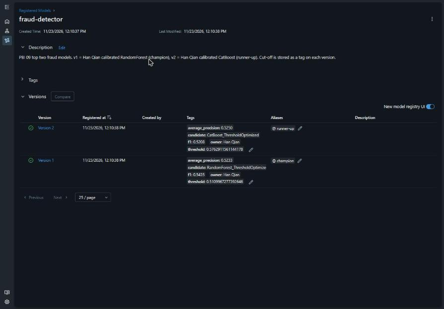
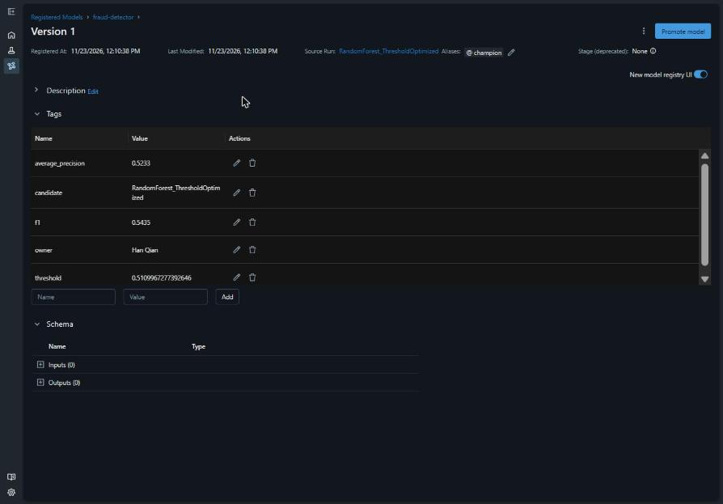
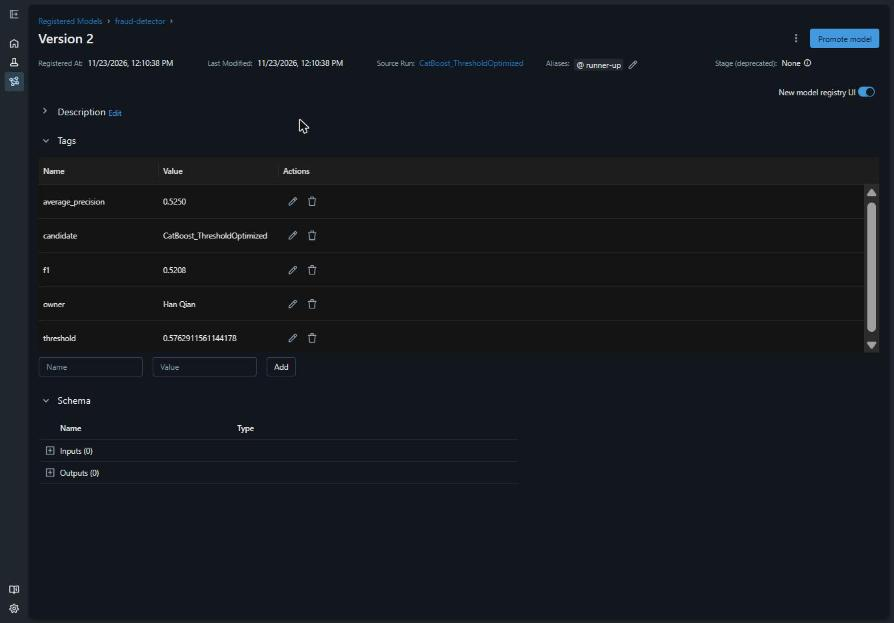
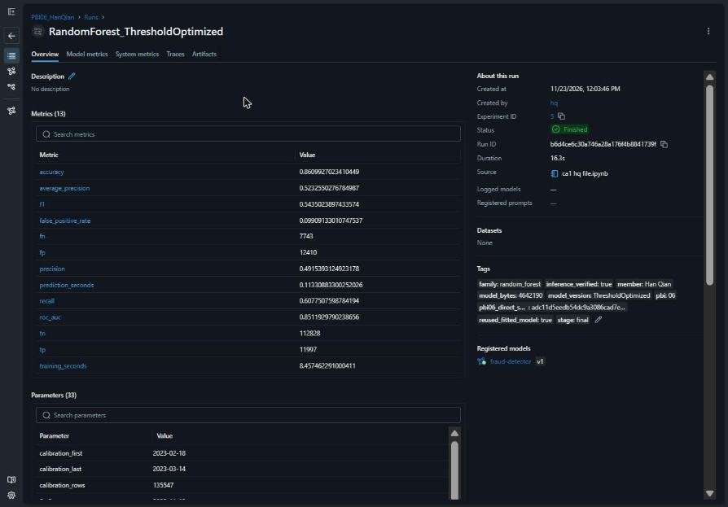
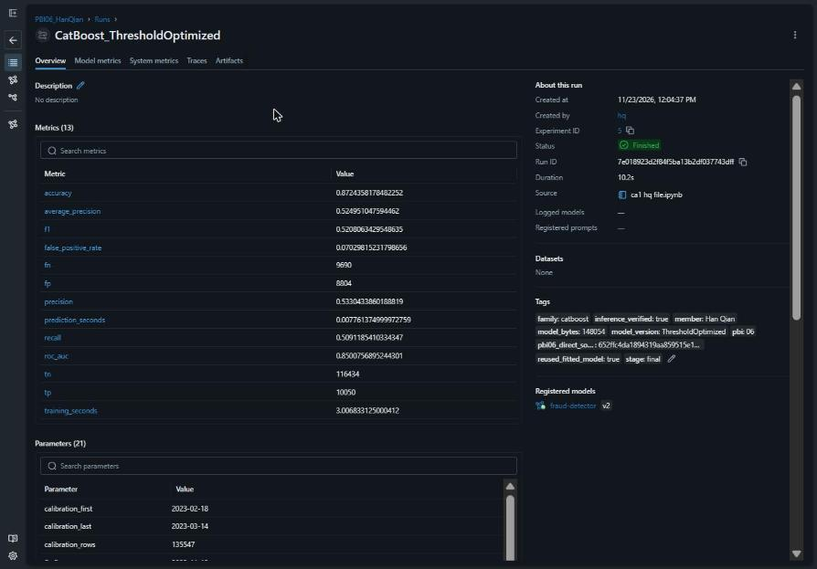
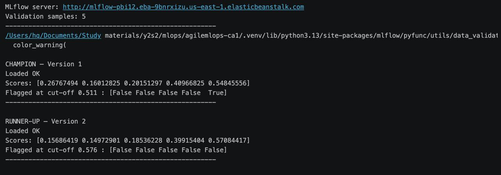
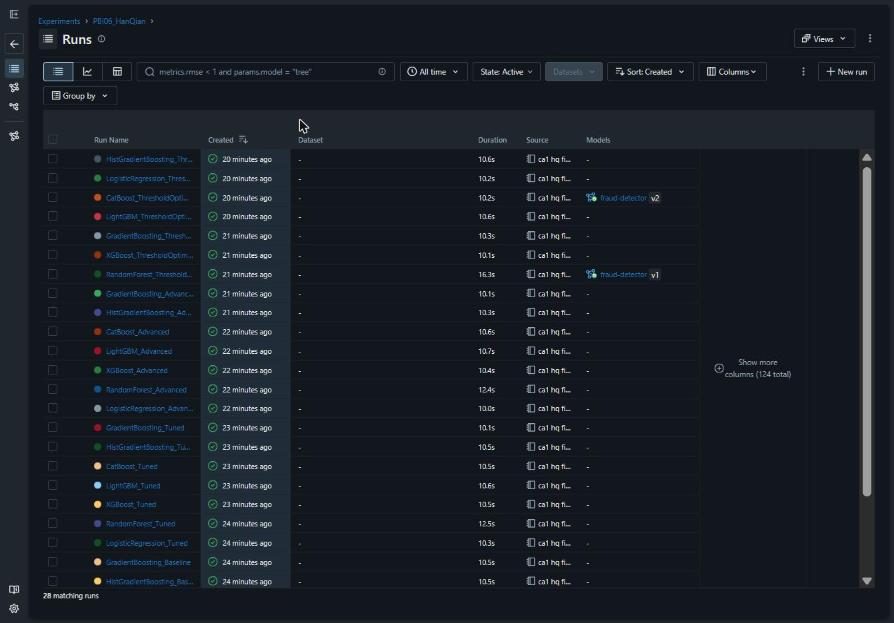
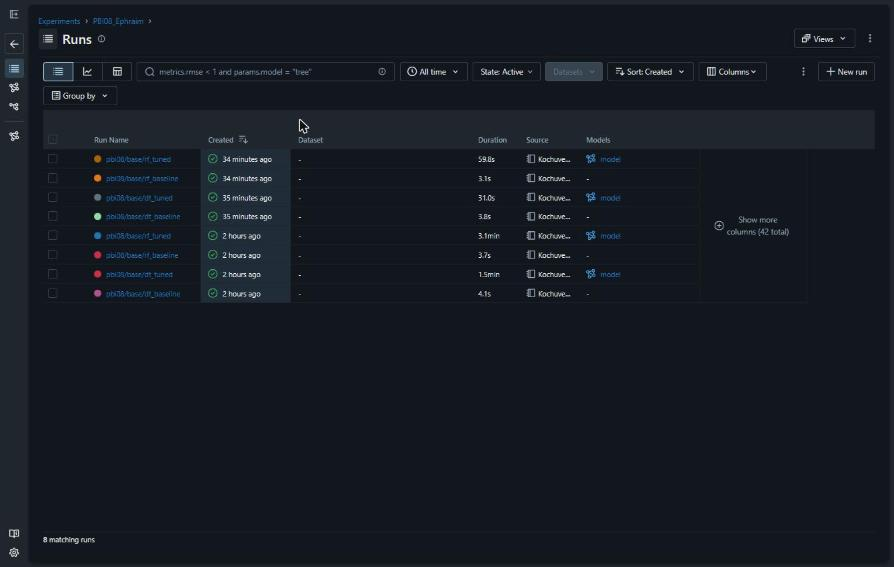
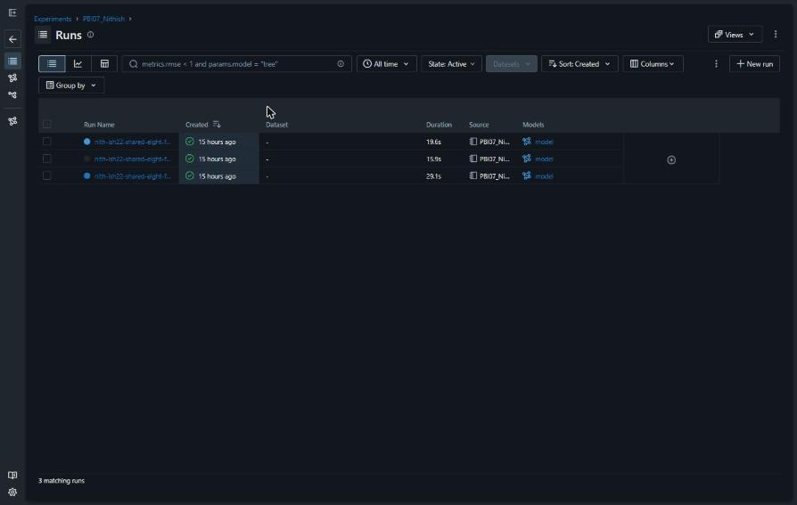
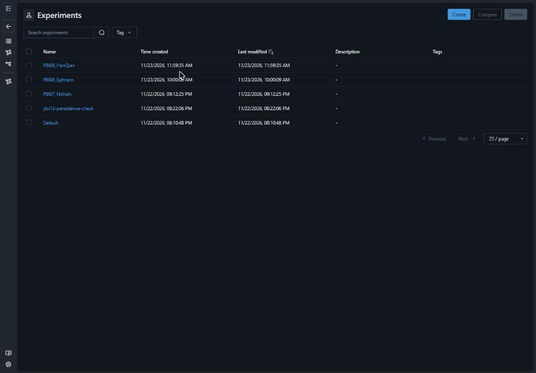

# PBI 09 Fraud Model Comparison, Top-Two Registration and Champion

**Owner:** Nithish (`@nith-ish22`)

**Team:** Group 3 (Nithish, Han Qian, Ephraim)

**Scrum meeting:** 19 November 2026

**Registered in MLflow:** 23 November 2026, 12:10 SGT

**Status:** Top two registered, champion set, load test passed. Items still open are listed in section 10.

## 1. Outcome

| Role | Model | Registry entry | Source run | Cut-off |
| --- | --- | --- | --- | ---: |
| **Champion** | Random Forest, calibrated (Han Qian, PBI 06) | `fraud-detector` version 1, alias `champion` | `b6d4ce6c30a746a28a176f4b8841739f` | 0.5110 |
| **Runner-up** | CatBoost, calibrated (Han Qian, PBI 06) | `fraud-detector` version 2, alias `runner-up` | `7e018923d2f84f5ba13b2df037743dff` | 0.5763 |

- MLflow server: `http://mlflow-pbi12.eba-9bnrxizu.us-east-1.elasticbeanstalk.com` (MLflow 3.17.2, RDS MySQL metadata, S3 artifacts, set up in PBI 12).
- Model URIs: `models:/fraud-detector@champion` and `models:/fraud-detector@runner-up`.
- The cut-off, F1 and average precision (AP) are stored as tags on each version, so the operating point travels with the model.
- A teammate loaded both versions from the shared server and scored sample orders (section 7).

## 2. Business context

SP-buy users place orders every day. Some orders are fraud: the customer places an order and then asks for a refund without a valid reason. Fraud costs vendors and the platform money and harms the platform's reputation (CA1 specification, section 2.1).

The Trust & Safety team reviews orders that get flagged as risky before they ship. The analysts have limited time each day, and the current hard-coded rules increasingly flag loyal customers for no good reason. The model therefore has two jobs: catch as much fraud as possible, and keep the flagged list small enough for the analysts to review without troubling good customers.

About 13.6% of validation orders are fraud (19,740 of 144,978), so accuracy is not used: approving every order would still look about 86% accurate. The comparison uses precision, recall, F1, AP, ROC-AUC and review workload.

The system sends orders for human review. It does not reject orders or customers automatically.

## 3. Scrum meeting record

| Field | Entry |
| --- | --- |
| Date | 19 November 2026 |
| Participants | Nithish, Han Qian, Ephraim |
| Models reviewed | The first models trained by each member: Han Qian (PBI 06), Nithish (PBI 07), Ephraim (PBI 08) |
| Decision | The team chose Han Qian's calibrated Random Forest and calibrated CatBoost as the top two, with the Random Forest as the champion. The decision was made in the Scrum meeting. |
| Basis | Comparable metrics on the same validation window (sections 4 and 5), and the business needs in section 2 |

The 19 November server was later replaced by the durable PBI 12 server, so the models were published again on 23 November and registered from the new runs (section 6). The numbers did not change.

## 4. Candidates and results

All figures come from the shared MLflow server on 23 November 2026. Every candidate is scored on the same validation window: 15 March to 13 April 2023, 144,978 orders, 19,740 of them fraud.

### Table A. Cut-off chosen on a calibration slice (like-for-like)

Han Qian's `ThresholdOptimized` runs and Nithish's v2 and v3 fit on older training dates, choose the cut-off that maximises F1 on the newest slice of the training period, then score the validation window once.

| Candidate | Cut-off | F1 | Precision | Recall | AP | ROC-AUC | False alarms | Missed fraud |
| --- | ---: | ---: | ---: | ---: | ---: | ---: | ---: | ---: |
| **Han Random Forest** | 0.511 | **0.5435** | 0.4915 | 0.6078 | 0.5233 | 0.8512 | 12,410 | 7,743 |
| Han XGBoost | 0.548 | 0.5280 | 0.5214 | 0.5348 | 0.5234 | 0.8484 | 9,689 | 9,183 |
| Han Gradient Boosting | 0.528 | 0.5262 | 0.5119 | 0.5413 | 0.5238 | 0.8476 | 10,189 | 9,054 |
| Han LightGBM | 0.581 | 0.5222 | 0.5285 | 0.516 | 0.5219 | 0.8476 | 9,089 | 9,554 |
| Nithish v2 (logistic) | 0.648 | 0.5222 | 0.472 | 0.5845 | 0.5082 | 0.8418 | 12,908 | 8,202 |
| Nithish v3 (histogram gradient boosting) | 0.711 | 0.5221 | 0.5256 | 0.5187 | 0.5197 | 0.8477 | 9,244 | 9,500 |
| **Han CatBoost** | 0.576 | 0.5208 | 0.5330 | 0.5091 | **0.5250** | 0.8501 | **8,804** | 9,690 |
| Han Logistic Regression | 0.489 | 0.5201 | 0.4723 | 0.5787 | 0.5070 | 0.8408 | 12,762 | 8,317 |
| Han Histogram Gradient Boosting | 0.546 | 0.5176 | 0.5266 | 0.509 | 0.5159 | 0.8481 | 9,033 | 9,693 |

### Table B. Fixed 0.5 cut-off with class weighting

Ephraim's runs, Han Qian's `Baseline` stage and Nithish's v1 use a fixed 0.5 cut-off. This raises recall and review load. F1 here is not comparable with Table A. AP and ROC-AUC are comparable.

| Candidate | F1 | Precision | Recall | AP | ROC-AUC | False alarms | Missed fraud |
| --- | ---: | ---: | ---: | ---: | ---: | ---: | ---: |
| Ephraim `rf_tuned` | 0.5346 | 0.4003 | 0.8047 | 0.5390 | 0.8583 | 23,796 | 3,856 |
| Ephraim `dt_tuned` | 0.5274 | 0.3982 | 0.7806 | 0.5024 | 0.8470 | 23,287 | 4,330 |
| Han XGBoost baseline | 0.5435 | 0.419 | 0.774 | 0.5236 | 0.8472 | 21,203 | 4,461 |
| Han Random Forest baseline | 0.5405 | 0.413 | 0.781 | 0.5265 | 0.8477 | 21,908 | 4,318 |
| Han CatBoost baseline | 0.5385 | 0.4108 | 0.7813 | 0.5247 | 0.8498 | 22,121 | 4,317 |
| Nithish v1 (logistic) | 0.4782 | 0.3413 | 0.7983 | 0.5082 | 0.8418 | 30,411 | 3,981 |
| Ephraim `rf_baseline` | 0.3906 | 0.6226 | 0.2845 | 0.4629 | 0.8069 | 3,405 | 14,123 |
| Ephraim `dt_baseline` | 0.3663 | 0.3995 | 0.3382 | 0.2253 | 0.6292 | 10,037 | 13,063 |

### Same model or just another cut-off

Several runs are the same fitted model scored at a different cut-off, so they are not registered as separate models. Equal AP and ROC-AUC to four decimals shows this: Nithish v1 and v2 (AP 0.5082), and each Han Qian family's `Advanced` and `ThresholdOptimized` stages. Han Qian's CatBoost `Advanced` and `Tuned` runs also match to every digit read, so they are probably one model. One registry version is kept per trained model, with the cut-off recorded as a tag.

## 5. Why these two

The two registered models answer the two needs in section 2.

**Champion: Random Forest (calibrated).**
- Highest F1 under the like-for-like protocol (0.5435).
- Catches the most fraud among the calibrated models: recall 0.6078, with 7,743 fraud orders missed.
- Workload is about 814 reviews a day ((11,997 true positives + 12,410 false alarms) / 30).

**Runner-up: CatBoost (calibrated).**
- Best AP among the calibrated models (0.5250) and the best precision (0.5330).
- Fewest false alarms (8,804), about 628 reviews a day, so it is the gentler option for analysts and loyal customers.
- Much smaller and faster than the Random Forest: model size 148,054 bytes against 4,642,190, and about 0.008 seconds to score the validation set against 0.113.

**Trade-off between the two.** The Random Forest catches 1,947 more fraud orders and flags 3,606 more good orders, which is 5,553 more reviews over the 30 days (about 185 a day). The wider net pays off if one missed fraud order costs the business more than about 2.85 reviews. The team has no agreed cost figures, so this is an illustrative break-even and not a business estimate. If analyst capacity is limited to about 650 reviews a day, CatBoost fits within it and the Random Forest does not.

**Why not the others.**
- Ephraim `rf_tuned` has the best AP (0.5390), but at a fixed 0.5 cut-off it flags about 27% of all orders (about 1,320 reviews a day) at 40% precision. That is the analyst overload and loyal-customer friction described in section 2. It also uses a different protocol, so its F1 is not comparable. It stays a challenger: it can be re-evaluated under the calibrated rule and registered later.
- Nithish v3 has workload close to CatBoost, with lower AP (0.5197) and lower precision (0.5256).
- Han XGBoost is close on F1 (0.5280) but has lower AP than CatBoost at a similar workload.

**Reading the differences.** F1 gaps under about 0.02 are within what one validation window can resolve, so Random Forest versus XGBoost (0.0155) is not a decisive gap. AP for the leading calibrated models sits in a narrow band: Nithish v3 0.5197, Random Forest 0.5233, XGBoost 0.5234, Gradient Boosting 0.5238 and CatBoost 0.5250. The choice rests on workload and business fit as much as on the metric ranking.

## 6. Fairness checks

| Check | Han Qian (PBI 06) | Nithish (PBI 07) | Ephraim (PBI 08) |
| --- | --- | --- | --- |
| Data and cleaning | Shared PBI 02/03 base data | Same | Same |
| Validation window | 15 Mar to 13 Apr 2023, 144,978 orders | 15 Mar to 13 Apr 2023, 144,978 orders | Same window (confusion counts add to 144,978) |
| Fit rows | 525,226 (12 Nov 2022 to 17 Feb 2023) | 525,226 | Not logged on the run |
| Calibration slice | 135,547 rows (18 Feb to 14 Mar 2023) | 135,547 rows (18 Feb to 14 Mar 2023) | None |
| Cut-off rule | Table A: calibration slice. Baseline: fixed 0.5 | v2, v3: calibration slice. v1: fixed 0.5 | Fixed 0.5 with class weighting |
| Features | Eight shared columns | Eight shared columns | Same eight columns as logged on the run |
| Seed | 42 | 42 | 42 |

Han Qian's and Nithish's runs log the same fit rows, calibration slice, validation window and seed, so Table A is a like-for-like comparison and the champion and runner-up are directly comparable. Ephraim's runs do not log fit rows or a calibration slice, so his F1, precision and recall are not ranked against Table A.

## 7. Registry record and load test

### Registry record

| Field | Champion | Runner-up |
| --- | --- | --- |
| Registered model name | `fraud-detector` | `fraud-detector` |
| Version | 1 | 2 |
| Candidate | `RandomForest_ThresholdOptimized` | `CatBoost_ThresholdOptimized` |
| Source run ID | `b6d4ce6c30a746a28a176f4b8841739f` | `7e018923d2f84f5ba13b2df037743dff` |
| Source experiment | `PBI06_HanQian` (experiment 5) | `PBI06_HanQian` (experiment 5) |
| Source artifact | run artifact folder `model` | run artifact folder `model` |
| Model URI | `models:/fraud-detector/1` | `models:/fraud-detector/2` |
| Alias | `champion` | `runner-up` |
| Cut-off (tag `threshold`) | 0.5109967277392646 | 0.5762911561144178 |
| F1 / AP (tags) | 0.5435 / 0.5233 | 0.5208 / 0.5250 |
| Precision / recall | 0.4915 / 0.6078 | 0.5330 / 0.5091 |
| ROC-AUC | 0.8512 | 0.8501 |
| True / false positives | 11,997 / 12,410 | 10,050 / 8,804 |
| False negatives | 7,743 | 9,690 |
| Registered by, date | Nithish, 23 November 2026, 12:10 SGT | Nithish, 23 November 2026, 12:10 SGT |
| Status | READY | READY |

### Where to find everything (acceptance criterion 3)

- Registered model page: `http://mlflow-pbi12.eba-9bnrxizu.us-east-1.elasticbeanstalk.com/#/models/fraud-detector` shows both versions, their aliases and tags.
- Version page: select a version to see its source run link, tags and aliases.
- Source run: the run page shows all metrics, parameters, the `Registered models` link back to the version, and the artifacts (`model`, confusion matrix, precision-recall plot, `tuning_summary.json`).

### Load test by a teammate (acceptance criterion 3)

- **Tester:** Han Qian, on his own computer (Python 3.13 environment), 23 November 2026, around 12:20 SGT.
- **What was run:** the code below, pointing at the shared server.
- **Result:** both versions loaded from the registry by alias and returned scores for 5 validation orders. The screenshot is in section 11.

| Version | Loaded | Scores for the 5 orders | Flagged at the cut-off |
| --- | --- | --- | --- |
| 1, champion (cut-off 0.511) | OK | 0.268, 0.160, 0.202, 0.410, 0.548 | Only the fifth order |
| 2, runner-up (cut-off 0.576) | OK | 0.157, 0.150, 0.185, 0.399, 0.571 | None |

```python
import mlflow
mlflow.set_tracking_uri("http://mlflow-pbi12.eba-9bnrxizu.us-east-1.elasticbeanstalk.com")

# X = a few validation rows with the eight feature columns (no labels)
for alias, thr in [("champion", 0.511), ("runner-up", 0.576)]:
    uri = f"models:/fraud-detector@{alias}"
    try:
        m = mlflow.sklearn.load_model(uri)
        p = m.predict_proba(X.head(5))[:, 1]
    except Exception:
        m = mlflow.pyfunc.load_model(uri)
        p = m.predict(X.head(5))
    print(alias, "loaded OK", p, p >= thr)
```

The MLflow client printed a data-validation warning about input types. It is a notice and not an error.

## 8. Repeating the review for new versions (acceptance criterion 4)

Run this whenever a member trains a new model version:

1. Publish the run to the shared server with the cut-off, features, fit and validation rows, and seed as parameters.
2. Score it on the same validation window under the calibrated rule (Table A), and add a fixed-cut-off row (Table B) only for reference.
3. Compare against the current champion on F1, AP, precision, recall, false alarms and reviews per day. Check the new model is not the same fitted model at another cut-off.
4. Present the comparison at the Scrum meeting and record the date, participants and decision here.
5. If the team promotes it, register it as a new version of `fraud-detector` with the same tags, move the `champion` alias to it, and keep the old champion under the `runner-up` alias or an `archived` alias.
6. Have a teammate other than the model's author load it by alias and score a sample before the alias move is treated as final.

No new version has been trained since registration, so the repeat review has not yet been needed.

## 9. Acceptance criteria

| # | Criterion | Status | Evidence |
| --- | --- | --- | --- |
| 1 | Review each member's first model in the Scrum meeting and record date, participants, comparable metrics, run links and rationale | Done. Supporting minutes or photo to be attached if the team has them | Sections 3 to 5 |
| 2 | Register the top two as traceable MLflow versions and set the champion | Done | Section 7, screenshots 1 to 3 |
| 3 | Show where the champion's version, source run, metrics and artifacts can be accessed | Done | Section 7, screenshots 2 and 4 to 6 |
| 4 | Repeat the review when a new version is trained and record the decision | Procedure documented. No new version yet | Section 8 |
| 5 | Weekly Sprint and Scrum evidence: tasks, outputs, participation, pull-request reviews, owners, follow-up | Held by the team on the GitHub Project board and pull requests | Project board and pull-request links |

## 10. Limitations and open items

- One validation window and one seed per model, with no confidence intervals. Repeated selection on this window can make results look better than they will be on new data.
- The sealed test period (from 14 April 2023) has not been used. It should be used once, for the champion's final check.
- No agreed cost per missed fraud order or review capacity exists yet. The break-even in section 5 is illustrative. The team should replace it with real figures from Trust & Safety.
- The load test was run by the models' author. A second member loading the champion would make the evidence stronger.
- Run links work only while the shared server holds the runs. The server now stores metadata in RDS and artifacts in S3 (PBI 12), and runs while the AWS Learner Lab session is active. Run IDs are recorded above so the runs can be found again.
- Ephraim's `rf_tuned` is a challenger. It needs a calibrated, like-for-like re-run and logged fit rows before it can be ranked against the registered models.
- Country is an input feature. Per-country flag rates should be reviewed before any operational use, and results should only prioritise human review.

## 11. Evidence

Screenshots taken from the shared server on 23 November 2026 unless stated.



**Screenshot 1. Registered model `fraud-detector`.** Two versions with aliases `champion` and `runner-up` and the cut-off, F1 and AP tags.



**Screenshot 2. Version 1, champion.** Source run `RandomForest_ThresholdOptimized`, alias `champion`, tags including the cut-off 0.5109967277392646.



**Screenshot 3. Version 2, runner-up.** Source run `CatBoost_ThresholdOptimized`, alias `runner-up`, cut-off 0.5762911561144178.



**Screenshot 4. Champion source run.** Metrics, calibration and fit settings, and the link back to `fraud-detector` version 1.



**Screenshot 5. Runner-up source run.** Metrics and the link back to `fraud-detector` version 2.



**Screenshot 6. Load test by Han Qian.** Both versions loaded by alias from the shared server, with scores and flags at each cut-off.



**Screenshot 7. Han Qian's experiment, 28 finished runs.** The `fraud-detector` version links appear on the two registered runs.



**Screenshot 8. Ephraim's experiment, 8 runs.**



**Screenshot 9. Nithish's experiment, 3 runs.**



**Screenshot 10. Experiments on the shared server.**

### Earlier snapshot, 19 November 2026

The files `ss01` to `ss13` in `pbi09_evidence/` were taken on 19 November from the earlier MLflow server, before it was replaced. They show the empty registry and the earlier uploads at that time and are kept as history. They do not describe the current server.

### Sources

- CA1 specification, sections 2.1 to 2.3 (business background, stakeholders, PBI 09 requirement).
- [PBI 06 model comparison](PBI06_model_comparison.md) and [PBI 07 model comparison](PBI07_model_comparison.md).
- [PBI 09 issue](https://github.com/hqasdf/agilemlops-ca1/issues/9) and [PBI 12 issue](https://github.com/hqasdf/agilemlops-ca1/issues/12).
